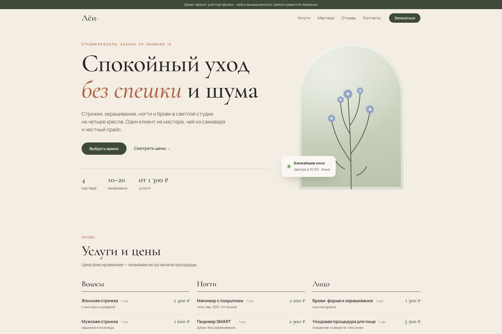
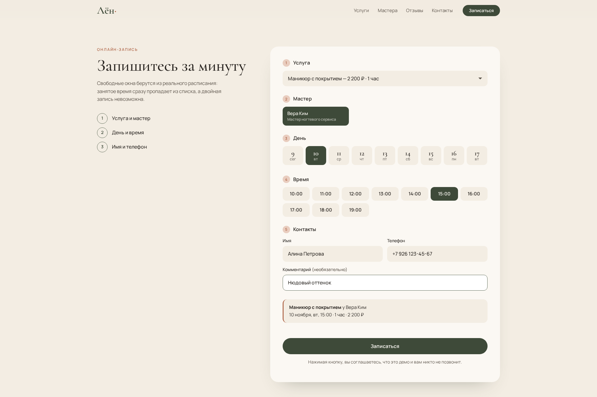
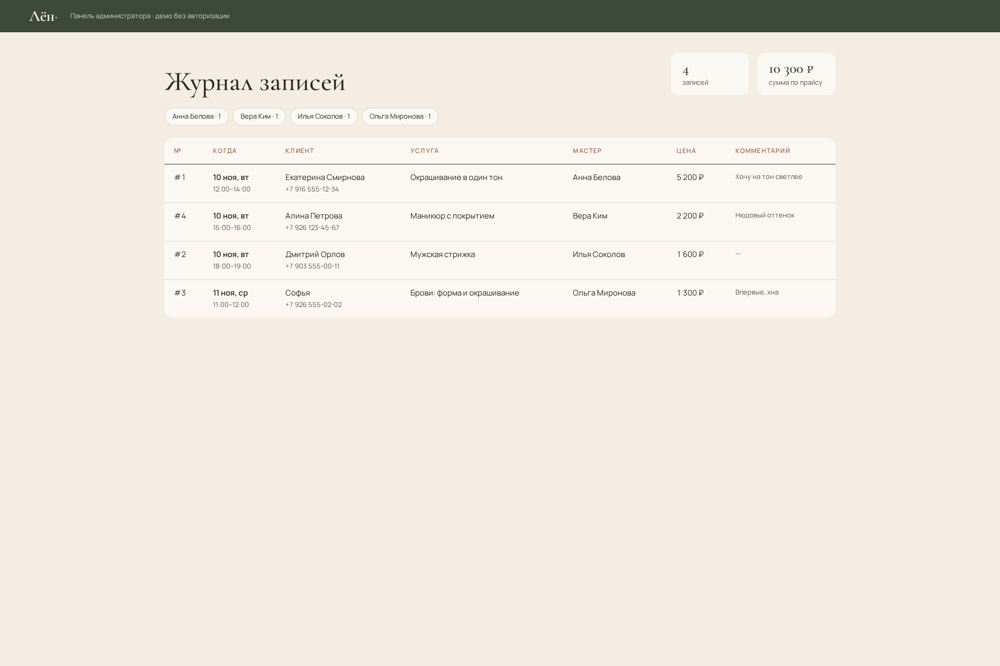

# Студия красоты «Лён» — демо-сайт с онлайн-записью

Демонстрационный проект для портфолио. Салон, адрес, телефон и отзывы **вымышлены**.

## Скриншоты






Лендинг на русском языке (главный экран, прайс, мастера, демо-отзывы, контакты) с
**работающей онлайн-записью**: клиент выбирает услугу, мастера, день и свободное время,
оставляет имя и телефон, и запись сохраняется в SQLite. Занятое время пропадает из выдачи,
а повторная запись на тот же слот отклоняется сервером (HTTP 409).

## Возможности

- Услуги длятся разное время (1–3 часа). Длинная услуга занимает несколько часов подряд,
  поэтому пересечения тоже отклоняются.
- Каждый мастер выполняет только свои услуги, и форма показывает подходящих мастеров.
- Сервер проверяет данные: часы работы 10:00–20:00, запись не дальше 30 дней вперёд,
  прошедшее время недоступно, телефон приводится к виду `+7 XXX XXX-XX-XX`.
- От двойной записи защищает ограничение `UNIQUE(master_id, day, hour)` в БД и транзакция
  `BEGIN IMMEDIATE`, так что защита работает и при одновременных запросах.
- `/admin` — журнал записей с суммой по прайсу (локальное демо, **без авторизации**).
- Вёрстка адаптирована под телефоны, на клиенте нет фреймворков (обычный JS).

## Стек

Python 3.11+ · FastAPI · SQLite (stdlib `sqlite3`) · HTML/CSS/JS ·
шрифты Google Fonts: Cormorant Garamond и Manrope (оба с кириллицей).

## Запуск

```bash
python -m venv .venv && . .venv/bin/activate
pip install -r requirements.txt
uvicorn app.main:app --port 8765
# сайт:    http://127.0.0.1:8765/
# админка: http://127.0.0.1:8765/admin
# API:     http://127.0.0.1:8765/api/docs
```

База создаётся автоматически в `data/salon.sqlite3`. Другой путь задаётся переменной `SALON_DB`.

## API

| Метод | Путь | Что делает |
|---|---|---|
| GET | `/api/catalog` | услуги, мастера, часы работы |
| GET | `/api/slots?service_id=&master_id=&day=YYYY-MM-DD` | свободные времена начала |
| POST | `/api/bookings` | создать запись: `{service_id, master_id, day, hour, name, phone, comment?}` → 201, 409 если занято, 422 при ошибке данных |
| GET | `/admin` | HTML-журнал записей |

## Тесты

```bash
pip install -r requirements-dev.txt
pytest -q
```

## Структура

```
app/catalog.py   услуги, мастера, график
app/db.py        SQLite-хранилище и защита от двойной записи
app/main.py      FastAPI: API, отдача статики
app/admin.py     серверный рендер админки (с экранированием)
static/          index.html, styles.css, app.js, admin.css
tests/           тесты API
```

## Ограничения демо

Нет авторизации в админке, нет отмены и переноса записей, нет SMS-уведомлений.
Перерывы и выходные дни мастеров не учитываются. Время считается по часам сервера.
